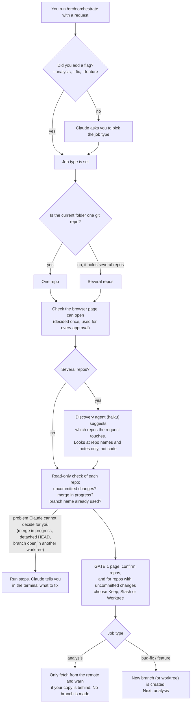
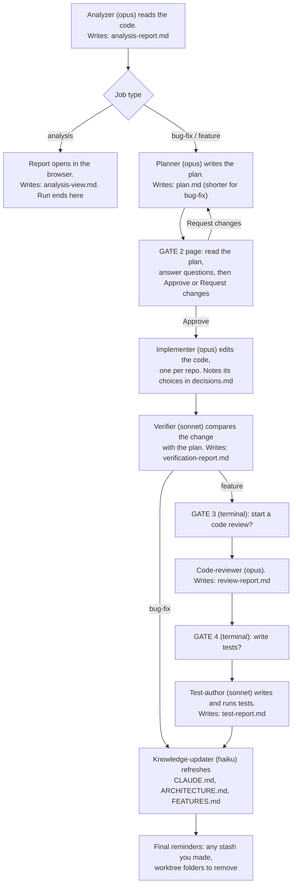
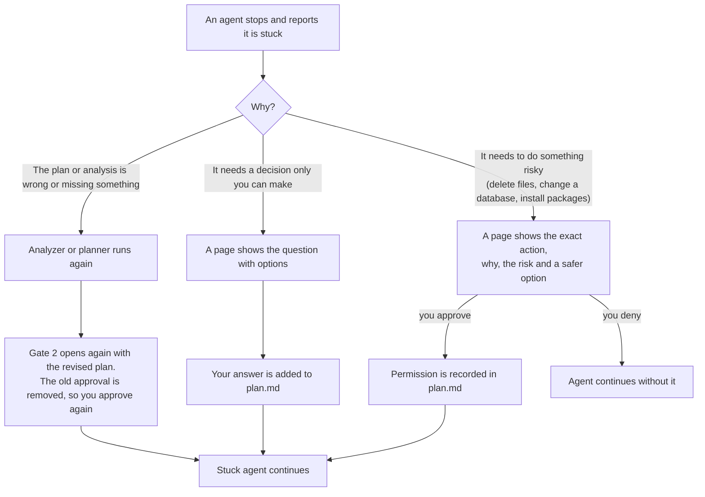

# cross-repo-orchestrator

A Claude Code plugin that analyses, fixes and builds features across one or many repos. It detects single vs cross-repo, picks only the stages the task needs, prepares the git branch, and stops at gates where you decide. Gates 1 and 2 can be answered in a **browser page** instead of the console.

## Install

In Claude Code:

```
/plugin marketplace add jaison10/cross-repo-orchestrator
/plugin install orch@repo-orchestrator-marketplace
/reload-plugins
```

Nothing else to install. The browser page is served by a small binary that ships inside the plugin (Windows x64, macOS Apple silicon, Linux x64 including WSL) and carries its own runtime.

## Use

```
/orch:orchestrate [--analysis | --fix | --feature] <what you want>
/orch:show <file.md>
/orch:code-review <repo or path>
/orch:jira-story [plan path]
```

Pass a route flag to pick the route yourself (`--bug` is an alias for `--fix`). Without one, you are asked to choose between analysis, bug-fix and feature, with the orchestrator's guess pre-selected.

An analysis is shown in the browser as a short report: a TL;DR, flowcharts and sequence diagrams (drawn offline, no network), a components table, findings and assumptions, with collapsible sections, Expand/Collapse all, a "Show details" toggle, Copy as Markdown, enlargeable diagrams and Print. `show` opens any markdown file the same way.
`/orch:jira-story` shows the story the same way, with Copy buttons per section and for the whole description, in Jira Cloud (rich text) or wiki markup (Server/DC) format.

## How it works

The orchestrator is the main thread (your session model). It never reads repo source; it dispatches subagents and passes only paths and short summaries between them. Only the main thread talks to you.

### Stage 0 and Gate 1: setup and your first approval

**What this stage does:** before any analysis, it works out *what kind of job this is*, *which repos are involved*, and *where the changes will be made*. Nothing is changed in your repos until you approve on the Gate 1 page.



**Plain-language key**

| Term | Meaning |
|---|---|
| Job type (route) | `--analysis` = explain only, `--fix` = bug fix, `--feature` = new feature. |
| Check the browser page can open | Claude reads your `ui` setting and starts the small local web server (port 4402). If that works, all approvals show as web pages. The terminal is used instead when `ui` is `console`, you are on an SSH session, or the server cannot start. It says why once. |
| Discovery suggests repos | Only when you run from a folder holding several repos. It lists the repos that look relevant, with a reason each. You confirm or change the list at Gate 1. |
| Read-only check | Claude looks at git state only. Nothing is changed yet. |
| Keep / Stash / Worktree | Only for repos with uncommitted changes. **Keep**: carry your changes onto the new branch. **Stash**: put them aside, start from a clean branch (get them back with `git stash pop`). **Worktree**: leave your folder untouched and make the new branch in a separate folder. |
| Gate 1 page | The first approval page. It is saved as `gates/gate-1.json` in the task folder (you never edit it). |
| Fetch and warn | Downloads the latest remote info and tells you if your checkout is behind. Analysis never creates a branch. |
| Work folder, main folder, start point | Internal names the agents use: the folder where code is edited (your repo, or the worktree), your main repo folder, and the commit the new branch starts from (usually `origin/<base branch>`). |

### Stages after Gate 1: analyze, plan, approve, build, check

**What these stages do:** read the code to understand your request, write a plan, wait for your approval, make the change, then check it. Nothing is built until you approve the plan at Gate 2.



**Plain-language key**

| Term | Meaning |
|---|---|
| Analyzer | Reads the relevant code and explains what your request involves (goal, scope, findings, assumptions). |
| Planner | Turns that understanding into a step-by-step plan, plus a plain summary and any questions for you. |
| Gate 2 | The approval page for the plan. **Approve** lets the build start. **Request changes** sends your concerns back to the planner. Questions must be answered first. |
| Implementer | Makes the code changes in your work folder, following the plan only. It never commits. |
| Verifier | Checks the change does what the plan says and flags anything extra. It edits nothing. |
| Gate 3 / Gate 4 | Simple yes/no questions in the terminal: review the code? write tests? (Feature jobs only; for bug-fix they are skipped unless you ask.) |
| decisions.md | A short log of choices the implementer made, stored in the repo's `.claude/orchestrator/`. |
| Report page (analysis jobs) | Instead of a plan, you get the analysis as a readable page with a Done button and a question box. |

| Job type | Stages |
|---|---|
| analysis | Setup, Gate 1 (repos only), fetch, analyzer, report page. Stops there: no branch, no plan. |
| bug-fix | Setup, Gate 1, analyzer (narrow), planner (short), **Gate 2 (always)**, implementer, verifier, knowledge-updater. |
| feature | Everything, including Gates 3 and 4. |
| several repos | Any job type: discovery runs first, and Gate 1 shows the repo list and branch choices together. |

### When an agent gets stuck (blockers)

Any agent may stop and ask instead of guessing. This is called a **blocker**. Claude shows it to you and continues only after your answer.



**Plain-language key**

| Term | Meaning |
|---|---|
| Blocker | A stop-and-ask report from an agent. Types: `needs-analysis`, `question`, `permission`. |
| Page for blockers | Saved as `gate-5.json`, `gate-6.json`, ... in the task's `gates/` folder (you never edit them). |
| Approval removed | A revised plan is a new plan, so the "Approved" line in `plan.md` is dropped until you approve again. |

### Agents, models, inputs and outputs

| Stage | Agent | Model | Reads | Produces |
|---|---|---|---|---|
| 0, gates, branch prep | orchestrator (main thread) | inherits the session model | request, config, git state | the approval pages (`gates/gate-N.json`); reads your answers (`gate-N.state.json`) |
| 0b (cross-repo) | discovery | haiku | repo names, listings, first ~50 lines of README/CLAUDE.md, manifests | a short list of likely repos with a reason each (no files written) |
| analyze | analyzer | opus | code in the work folder, ARCHITECTURE.md, FEATURES.md | `analysis-report.md`, `analysis-view.md` (analysis route), ARCHITECTURE.md/FEATURES.md if missing or stale |
| plan | planner | opus | `analysis-report.md`, code in the work folder | `plan.md` |
| implement | implementer | opus | approved `plan.md` (shared + own repo section), `rules/*.md` | code in the work folder, choices logged in `decisions.md` |
| verify | verifier | sonnet | `plan.md`, the git diff since the branch started, plus new files | `verification-report.md` |
| review | code-reviewer | opus | change set, `rules/*.md` | `review-report.md` |
| test | test-author | sonnet | change set, FEATURES.md, review findings, `rules/general.md`, `rules/coding.md` | tests in the work folder, `test-report.md` |
| knowledge | knowledge-updater | haiku | change set | CLAUDE.md (work folder root), ARCHITECTURE.md, FEATURES.md |
| `/orch:jira-story` | main thread, `jira-story` skill | sonnet (skill) | `plan.md`, optional `analysis-report.md` | `jira/STORY-<slug>-<date>.md` |

The implementer and code-reviewer pick rule files by change type: `general.md` and `coding.md` always, plus `database.md`, `api.md`, `security.md`, `dotnet.md`, `efcore.md` when relevant.

## Where things live

`~/.orchestrator/` (`%USERPROFILE%\.orchestrator\` on Windows), central, outside the repo:

| Path | Contents |
|---|---|
| `config.json` | Optional, created the first time it is needed (a setup form opens in the browser, or the terminal asks). Keys below. |
| `<parent-key>/tasks/<task-slug>/` | `analysis-report.md`, `analysis-view.md`, `plan.md`, `verification-report.md` (whole-feature; single-repo: the one key) |
| `<parent-key>/tasks/<task-slug>/gates/` | `gate-N.json` (what Claude showed) and `gate-N.state.json` (what you answered) |
| `<parent-key>/tasks/<task-slug>/jira/` | `STORY-<slug>-<YYYY-MM-DD>.md` from `/orch:jira-story` |
| `<repo-key>/tasks/<task-slug>/` | `review-report.md`, `test-report.md` (per repo) |
| `<repo-key>/reviews/` | `review-<timestamp>.md` from standalone `/orch:code-review` |
| `<repo-key>/tasks/show-<file-stem>-<YYYY-MM-DD>/gates/` | the page for `/orch:show` |
| `server.log` | requests and errors of the page server |

In the repo, durable:

- `CLAUDE.md` at the root of the folder where code is edited (tracked, rides on the feature branch; holds the team's `## Branching` block).
- `ARCHITECTURE.md`, `FEATURES.md`, `decisions.md` under `.claude/orchestrator/` in your main repo folder, git-excluded via `.git/info/exclude` (never `.gitignore`).
- Cross-repo only: `<parent>/.claude/orchestrator/WORKSPACE.md`, an index of the repos.

`repo-key` is `<folder-name>-<first 8 hex of SHA-1 of the main repo path>`; worktrees of one repo share it.

## Commands

### `/orch:orchestrate [--analysis | --fix | --feature] <requirement>`

Runs the pipeline above. The flag can be anywhere in the request and is stripped from the requirement.

| Option | Effect | Example |
|---|---|---|
| `--analysis` | Read-only analysis, shown as a report page. No branch, no plan. | `/orch:orchestrate --analysis how are refunds calculated` |
| `--fix` | Bug-fix route: narrow analysis, light plan, Gate 2, implement, verify. | `/orch:orchestrate --fix refund total ignores tax` |
| `--bug` | Alias for `--fix`. | `/orch:orchestrate --bug login fails after timeout` |
| `--feature` | Feature route: all stages and gates. | `/orch:orchestrate --feature add partial refunds` |
| none | You pick the route in the console; the guess is marked (Recommended). | `/orch:orchestrate add partial refunds` |

Two different route flags make it ask which one you meant. You can change the route later at any gate.

### `/orch:show <file.md>`

Opens any markdown file (plan, old analysis) as a report page. No pipeline run. Always uses the browser, whatever `ui` says; prints to the console only if `start` fails. Done closes it, "Show in terminal instead" prints it, and you can ask follow-up questions on the page.

```
/orch:show C:/Users/me/.orchestrator/shop-1a2b3c4d/tasks/refund-endpoint-2026-11-15/plan.md
```

### `/orch:code-review [repo or path]`

Runs the code-reviewer alone, with no pipeline state. No path: the current folder. It reviews uncommitted changes, or the last commit if the tree is clean, and writes `~/.orchestrator/<repo-key>/reviews/review-<timestamp>.md`.

```
/orch:code-review
/orch:code-review C:/src/shop-api
```

### `/orch:jira-story [plan path]`

Turns an existing `plan.md` into one PM-style Jira story and shows it with Jira copy buttons. The orchestrator never calls it. The path is optional. With no path it uses `plan.md` (and `analysis-report.md` for Background) from the newest task folder of the current repo, and stops with "no plan found" if there is none. Pass a path only to pick a different task. A bare `plan.md` is not resolved; give the full path. A plan outside `~/.orchestrator/<key>/tasks/<task-slug>/` uses `~/.orchestrator/<repo-key>/tasks/jira-<plan-stem>-<YYYY-MM-DD>/`. Earlier stories are never overwritten (`-2`, `-3`, ...).

```
/orch:jira-story
/orch:jira-story C:/Users/me/.orchestrator/shop-1a2b3c4d/tasks/refund-endpoint-2026-11-15/plan.md
```

## Browser gates

At Gate 1 (repos and branches) and Gate 2 (plan) the orchestrator opens a local page showing:

- what Claude understood, with its assumptions
- the effective repos, why each is in scope, and what to do with uncommitted changes (keep, stash, worktree)
- the plan: what changes, decisions, what is not being done
- the open questions, as cards with answer options and a recommended pick
- a box to ask Claude your own questions (answered on the same page) and a box for concerns

Choose **Approve & continue**, **Request changes** (Claude revises and shows a new round) or **Answer in console instead**. The terminal resumes when you submit; closing the tab changes nothing and the gate stays open at the same URL. Approve stays disabled until every question is answered and every uncommitted-changes repo has a decision. After 30 idle minutes the terminal asks whether to keep waiting.

The page falls back to the console on its own when the browser UI is off, you are on an SSH session, or the server cannot start. Gates 3 and 4 are always in the console.

### Gate server CLI

`orchestrator-gate` is the binary in `skills/browser-gate/dist/<platform>/` (`win-x64/orchestrator-gate.exe`, `osx-arm64/orchestrator-gate`, `linux-x64/orchestrator-gate`). It is not on PATH; run it by full path.

```
orchestrator-gate open <gate-file> [--no-browser]
orchestrator-gate wait <gate-file> [--round N] [--timeout MIN]   # exit 2 = timed out
orchestrator-gate setup [--no-browser]
orchestrator-gate config
orchestrator-gate set <key> <value>
orchestrator-gate start | stop | status | serve | version
```

The server listens on `127.0.0.1:4402`, stays up between gates and exits after 4 idle hours.

### config.json keys

| Key | Default | Values | Example |
|---|---|---|---|
| `ui` | `browser` | `browser`, `console` | `orchestrator-gate set ui console` |
| `port` | `4402` | 1024-65535 | `orchestrator-gate set port 4410` |
| `browser` | `true` | `false` = do not auto-open the page | `orchestrator-gate set browser false` |
| `username` | none | git-ref-safe: no spaces, no `..`, no leading `-` | `orchestrator-gate set username jdoe` |
| `worktree-root` | none | absolute folder; empty value clears it | `orchestrator-gate set worktree-root C:/wt` |
| `idleMinutes` | `30` | 1-1440, how long `wait` waits without page activity | `orchestrator-gate set idleMinutes 60` |

## Troubleshooting

In the commands below, `GATE` is the full path of the binary for your platform, e.g. `"<plugin dir>/skills/browser-gate/dist/win-x64/orchestrator-gate.exe"`.

**Gates show in the console instead of the browser.** Claude prints the reason once at Stage 0.
- `ui` is `console`: `GATE set ui browser`.
- SSH session (`SSH_CONNECTION` set): console is expected; run Claude Code locally for the page.
- `start` failed: Claude prints its exact error. `port 4402 is in use by another program` means set another port: `GATE set port 4410`. `the server did not start` means read `~/.orchestrator/server.log`.
- Old plugin version cached (page lacks newer features): update the plugin, then `/reload-plugins`. A running server on an older version is replaced on the next `start`. Check with `GATE version` and `GATE status`.
- The page did not open: the URL is printed in the terminal; open it yourself (or `browser` is `false`).

**Gate 2 was skipped.** The implementer must never run before you approve Gate 2, on bug-fix too. Without `## Approved:` in `plan.md` the implementer returns a blocker. Tell Claude: "Show Gate 2 for plan.md before implementing." The analysis route has no Gate 2 by design (its report page is the only approval-style page).

**A question asked on the page got no answer.** The `wait` behind the page timed out (30 idle minutes, exit code 2) or the run ended, so nothing is listening. Tell Claude "continue the gate" (it re-runs `GATE wait <gate-file> --round <N>`); the page keeps its state at the same URL. Raise the timeout with `GATE set idleMinutes 60`.

**Rebuilding fails because the binary is locked (Windows).** The running server holds `orchestrator-gate.exe`. Stop it, then build:
```
GATE stop
bash ./build
```

**Jira copy buttons missing on `/orch:jira-story`.** The page is embedded in the binary; committed binaries older than the page change do not have them. Rebuild (`GATE stop`, then `bash ./build`), or update the plugin to a version whose binaries include it.

**PowerShell-only shell.** Claude runs the binary as `& "<skill base dir>\dist\win-x64\orchestrator-gate.exe" <command>`. It uses Bash when available and PowerShell only when not.

**A subagent could not write its report file.** Reports go to `~/.orchestrator/`, outside the project, and subagents cannot ask you for permission. Allow the folder for the session with `/add-dir ~/.orchestrator` (expand `~`) and re-run the stage.

**Stash or worktree conflicts.**
- Keep: if the switch would overwrite files, Claude stashes, switches, then pops. If the pop conflicts, it stops, lists the files and keeps the stash entry. Resolve the files, then `git stash list` and `git stash drop <entry>` once you no longer need it.
- Worktree: if the worktree folder already exists, Claude asks. The new folder lacks ignored files (`node_modules`, `bin/obj`, `.env`); restore or build there. If it is outside the launch folder, run `/add-dir <worktree folder>`.
- After merging: `git worktree remove <path>`.

**Branch already exists / checked out in another worktree.**
- Exists, not checked out: Gate 1 asks to reuse it or create `<branch>-2`.
- Checked out in another worktree: the run stops in the console. Find it with `git worktree list`, then switch that worktree to another branch or `git worktree remove <path>`, and re-run.
- BLOCKED (merge or rebase in progress, or detached HEAD): finish or abort it (`git merge --abort`, `git rebase --abort`) or `git switch <branch>`, then re-run.

**Missing `## Branching` block.** Gate 1 asks `base`, `remote` and whether to save the block. Choose "Add to CLAUDE.md", or add it yourself to the repo's CLAUDE.md:
```
## Branching
- base: develop
- remote: origin
- branch: {username}/{type}/{slug}
```

**Stale page after an update.** The server restarts itself on the new version the next time a gate opens.

## Privacy

The page is served on `127.0.0.1` only and answers only pages from itself (Host and Origin are checked). It shows the same summaries you would read in the console, never source files. Nothing leaves your machine.

## Developing

The page server is `src/OrchestratorGate` (.NET 10, ASP.NET Core; the page is `src/OrchestratorGate/page/index.html`, embedded in the binary), tests are in `src/OrchestratorGate.Tests`.

```
dotnet test src/OrchestratorGate.Tests
node src/page-check.mjs   # checks the page's markdown and wiki renderers
./build        # tests, then publishes the three committed binaries to skills/browser-gate/dist/
SHA=abc1234 ./build   # override the commit stamp where git cannot run
```

`./build` needs the .NET 10 SDK. It stamps the plugin version and commit into the binary, so the running server restarts itself on a new build, and it marks the macOS and Linux binaries executable in git. Bump `version` in `.claude-plugin/plugin.json` when releasing so Claude Code sees the update.

The protocol between the orchestrator and the page (gate file contract, actions, rounds) is in `skills/browser-gate/SKILL.md`.
